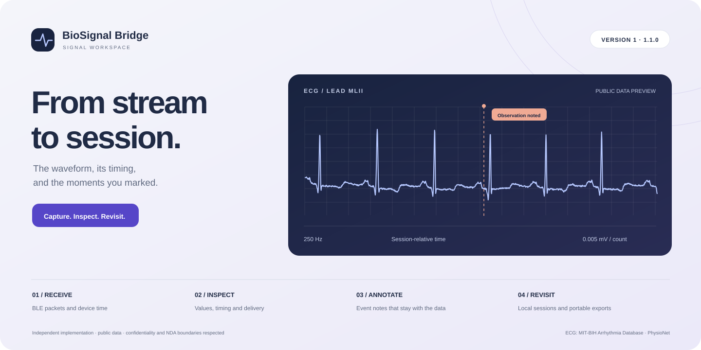
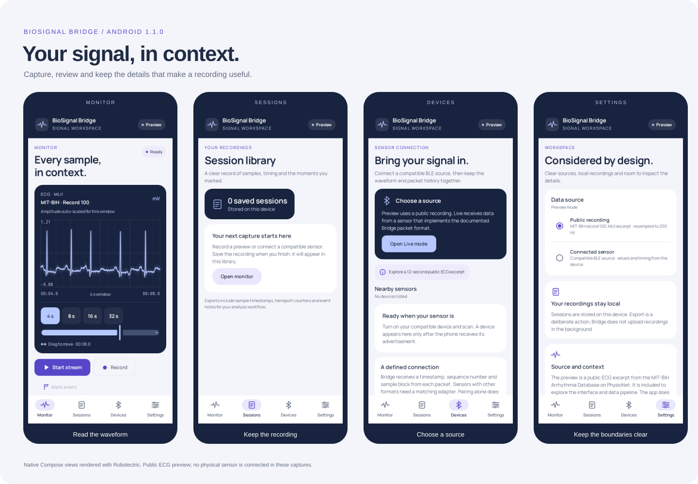

# BioSignal Bridge

**A recording is more useful when its context stays with it.**

Android signal capture, event notes and local review, with a self-contained browser workspace.

**Version 1 · 1.1.0** &nbsp; / &nbsp; Kotlin · Compose · Coroutines · Hilt · Room

The browser companion is a complete HTML file. Its public ECG recording, font and application code travel together.

BioSignal Bridge brings the practical work around a sensor recording into one place. Receive samples, watch their timing, mark an observation and keep a session that can be reviewed later. Midnight blue, iris, porcelain and a soft copper accent give Android and the browser a shared visual language.

The native app supports Android API 26 and later and targets API 36. It connects to one BLE peripheral implementing the documented Bridge protocol, with multiple logical channels in the stream.

## A closer look at a recording

- **Follow the waveform.** Change the time window, pause playback and move through recorded samples. A discontinuity breaks the trace so a missing passage remains visible.
- **Inspect the values.** The visible window reports amplitude, RMS, observed sample rate and segments. Measurements use the original samples rather than the reduced drawing path.
- **Keep the transport history.** Missing, duplicate, delayed and malformed packets have separate counters. Clock resets and receiver overflow remain visible, too.
- **Leave a useful note.** Mark a movement, sensor adjustment or observation and carry that note into the exported session.
- **Return to the details.** Android stores recordings in Room. The browser library supports search by name or event note, sorting, renaming, review and export.

The companion adds a full-recording overview and keyboard controls: Space for playback, arrow keys to move a second, and M to add an event note. Ordinary pointer and touch controls remain available.

## A clear boundary between layers

| Part | Responsibility |
| --- | --- |
| `app` | Compose presentation, process-owned acquisition, recording lifecycle and document export |
| `core/signal` | Packet contract, clock alignment, sequence handling, waveform reduction and constant-memory inspection |
| `core/capture` | `SignalTransport` contract and its BLE implementation, with connection ownership and deadlines |
| `core/storage` | Transactional Room writes, session recovery, event notes and display preferences |
| `demo/src` | Separate signal model, local session repository and browser presentation |
| `analysis` | Python validation, channel scaling and recording summaries |

The application depends on a transport contract rather than a Bluetooth implementation. Hilt supplies the production adapter and application coroutine scope. Integration tests supply their own transport and scope, keeping packet scenarios independent of a radio or private implementation fields.

[Architecture](docs/ARCHITECTURE.md) describes the boundaries and recording lifecycle. [The packet contract](core/signal/PROTOCOL.md) explains what a compatible sensor sends.

## The public ECG excerpt

The preview is a 12-second MLII passage from record 100 of the [MIT-BIH Arrhythmia Database](https://physionet.org/content/mitdb/1.0.0/). Its original 360 Hz samples are linearly resampled to 250 Hz for the Bridge packet example. The preview retains a scale of 0.005 mV per count; live sensors begin in raw ADC counts until calibration is established.

The browser replays this public excerpt. Its packet scenarios are separate, constructed examples that make transport faults easier to inspect. They do not alter the ECG or describe its original delivery quality. Source checksums, preparation steps and attribution are in [Data](docs/DATA.md).

## Take the context with the samples

Android exports a ZIP containing `session.csv`, `metadata.json` and, for a preview recording, `provenance.json`. Metadata includes source, channel units, event notes, delivery counters and a per-channel inspection summary. ZIP entry times are fixed so they do not add an unrelated export-time field.

The browser exports the same CSV fields and companion metadata. Recordings stay on the current device or browser. Export is a deliberate action. There is no account, telemetry or remote recording service.

The [export contract](docs/EXPORT.md) records the fields. The [Python reader](analysis/README.md) validates a recording before describing it.

## Confidentiality and NDA

This repository respects confidentiality and NDA boundaries. It is an independent implementation built from public concepts, public data and an original sample protocol. It includes no employer source code, customer recordings, internal endpoints, private hardware designs, proprietary sensor protocols or confidential visual assets.

The example BLE identifiers, packet format and interface belong to this project. They do not reveal a former employer's implementation. [Provenance and confidentiality](docs/PROVENANCE.md) records the public inputs and the boundaries used throughout the work.

## Verification and scope

[Validation](docs/VALIDATION.md) separates the checks run for this release from observations requiring a phone and peripheral. Domain, storage, application, export and browser suites are included with a continuous integration workflow.

Physical BLE capture and device accessibility need hardware review. This workspace supports signal engineering and recording review; it does not interpret a waveform as a diagnosis.

Original code uses the [MIT License](LICENSE). Third-party inputs retain the licences in [Notices](NOTICE.md).
