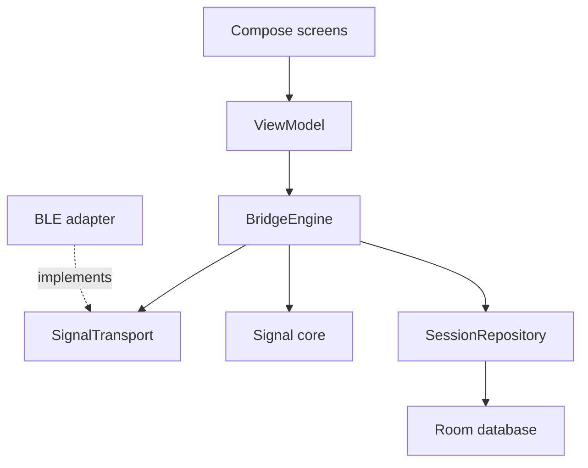

# Architecture

A process-owned `BridgeEngine` coordinates acquisition and recording. The Activity collects immutable state and sends actions through a Hilt view model. Presentation, transport, signal mathematics and persistence have separate responsibilities.

Compose presentation is split into focused monitor, session, device and settings screens. Common controls and typography live beside the shared theme; the entry point only selects the current screen.

## Ownership and cancellation

Hilt provides the application coroutine scope and transport. The foreground service shares that transport instance. Activity recreation does not create another connection, packet consumer or recording.

Stream changes, recording transitions and marker writes pass through one mutex. The scope is supervised. Cancellation exceptions are rethrown at recovery boundaries; cancellation is not reported as a recording failure. A process interruption is recovered from Room at the next launch.

Application tests inject their own transport and scope. They publish explicit frames through the public contract and cancel their scope during teardown, without reflection into the Bluetooth adapter.

## Receiving a stream

`SignalTransport` exposes connection state, discovered peripherals, received packets and overflow counters. Implementations own their connection and copy callback bytes before publishing them. Consumers subscribe before connecting. A full queue must be counted; it cannot silently discard earlier packets.

The BLE adapter scans for the Bridge service for up to ten seconds. A callback must match the current GATT object, connection token and expected characteristic or descriptor. Ready follows acknowledgement of the notification subscription.

Every connection phase has a deadline. Failed operations, disconnection and service changes close the connection. Permission failures are reported; reconnection is explicit. Live acquisition uses a `connectedDevice` foreground service. Scanning stops when the Activity leaves the foreground, and process death does not recreate a connection.

## Building the timeline

A notification carries one 20-byte packet. The codec checks signature, version, sample count, period and unused bytes. The processor tracks a global 16-bit sequence and 32-bit microsecond device counter, including rollover.

The first packet anchors to monotonic host receive time minus its sample span. Later samples retain their device intervals. This does not estimate radio latency or calibrate an oscillator. A confirmed reset creates a segment boundary. Channels remain individually monotonic; simultaneous channels may share a timestamp.

Sequence gaps estimate missing packets, not an exact count of missing samples. Duplicate, late and malformed packets have separate counters.

## Recording and recovery

Room stores session identity, source, scale, units, counters, indexed samples and event notes. Sample batches commit atomically. Arrival indices are contiguous; timestamp ordering is checked per channel.

A session supports 100,000 samples and 5,000 notes. These are explicit limits rather than rolling retention. Recordings end as complete, aborted or error. Open recordings left by process death become aborted at the next start. Previously committed measurements remain available after failure.

The live display retains 5,000 samples per channel, about twenty seconds at 250 Hz. Saved review and export use the recording rather than this display buffer.

## Inspection and export

`WindowInspector` makes one pass over a channel with constant memory. Normalised Welford accumulation keeps amplitude moments stable without overflowing intermediate squares for large valid scales. It reports calibrated minimum, maximum, mean, RMS and population standard deviation.

Observed rate is the inverse mean of positive adjacent intervals. Marked gaps and equal timestamps are excluded. Jitter is their population standard deviation in microseconds. ADC-limit counts refer to raw endpoints; they are not a diagnosis of clipping or a quality score.

Chart reduction preserves extrema and breaks. Inspection uses original visible samples, so drawing choices do not change the measurements. Export applies the same calculation to the full recording, separately per channel.

Export finishes an active recording before taking its snapshot. CSV retains raw counts and session-relative time; JSON retains source, scale, notes, counters and inspection. Host boot timestamps are excluded and ZIP entry times are fixed.

## The offline companion

`domain.mjs` owns packet mathematics and inspection, `storage.mjs` owns IndexedDB transactions, and `app.mjs` presents the interface. Writes succeed only when their complete transaction commits. An upgrade in another tab closes a stale database connection and explains how to reopen the workspace.

The build embeds modules, font and public data in one HTML file. There are no background network requests. Shared packet fixtures compare native and browser sequence, clock and gap behaviour. Numerical tests cover empty, discontinuous, multichannel, negative-scale and large-scale windows.
